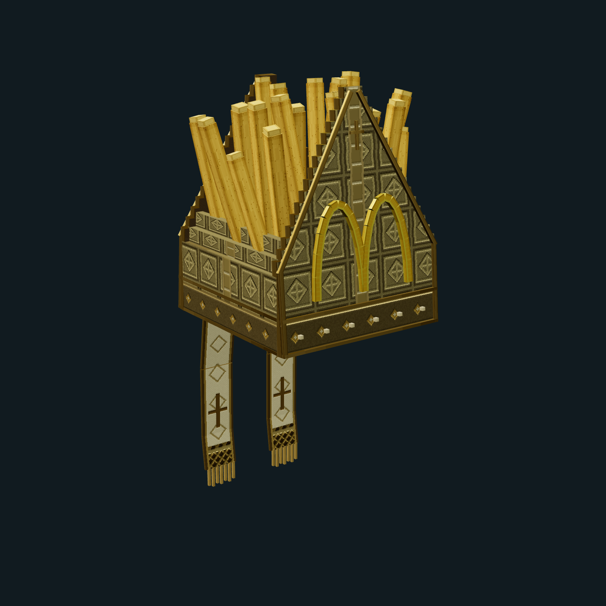

# Mitra Aurifrita — 0.1.2

Mitra equipável para Minecraft Bedrock, criada a partir da imagem fornecida pelo usuário: corpo dourado com brocado geométrico, dois arcos amarelos frontais em relevo e batatas saindo do topo. Frente e verso têm painéis inclinados e espessura real; duas ínfulas de tecido marfim terminam em franjas separadas. O verso recebe uma cruz dourada.



## Instalação

1. Abra `dist/releases/Aurifrita-0.1.2.mcaddon` no Minecraft Bedrock **26.40 ou posterior** (Creator `1.26.40`). A revisão remove o campo de wearable rejeitado no cliente 26.52; a arte permanece a da 0.1.1.
2. Ative **Aurifrita — Comportamento** e **Aurifrita — Recursos** em um mundo de teste. Nenhum experimento é necessário.
3. Obtenha **Mitra Aurifrita** no inventário Criativo ou execute `/give @s aurifrita:mitra 1`.
4. Coloque a peça no **slot de capacete**. Use a terceira pessoa para observar o modelo.

`/function aurifrita/dev_kit` também entrega uma mitra. A peça é cosmética: não possui scripts, poderes, proteção adicional, receita ou dependência de Aspergillum/Ornatum. O item e as localizações `pt_BR`/`en_US` são próprios deste add-on.

## O que foi construído

| Elemento | Implementação |
| --- | --- |
| Silhueta | Duas faces pontudas, com inclinação de 5°, bordas de ouro e reforços laterais |
| Arcos | 24 segmentos tridimensionais; o tecido aparece pelas aberturas |
| Batatas | 19 unidades, com alturas, larguras, rotações e pontas tostadas distintas |
| Tecido | Brocado, titulus central, faixa inferior com losangos, pontos de pérola e forro escuro |
| Ínfulas | Duas fitas com três dobras cada, cruzes bordadas e sete fios de franja por fita |
| Geometria | Bedrock `1.16.0`, 154 cuboides, 1.784 triângulos renderizados, 7 bones |
| Textura | Color, normal e MER de `256 × 256`, sem emissão; densidade principal de 16 texels por unidade |
| Memória das superfícies | 768 KiB decodificados nos três mapas, antes de mipmaps |
| Ícones | Inventário de 64 px e pack de 256 px, renderizados diretamente da malha real |

Os painéis e as laterais compartilham trechos do mesmo bordado; isso mantém os detalhes sem duplicar grandes áreas do atlas. Todas as UVs são explícitas e inteiras, com padding. A frente canônica é `-Z`; as ínfulas ficam em `+Z`. A raiz `head [0,24,0]` segue a composição de armadura vanilla, com a adaptação oficial do capacete no attachable específico do jogador.

## Fontes e reprodução

- `assets-src/design.mjs`: fonte autoral da geometria, paleta, bordados, UVs e distribuição das batatas.
- `assets-src/catalog/items.json`: catálogo consumido pelo Workbench.
- `assets-src/branding/`: renders promovidos e manifest com hashes dos inputs.
- `tools/build.mjs`: gera somente os packs deste subprojeto.
- `packs/resource/models/entity/mitra.geo.json`: geometria gerada, importável no Blockbench como modelo Bedrock.
- `packs/resource/textures/entity/mitra*.png`: mapas gerados; não editar manualmente.

As dependências são as já instaladas na raiz deste repositório e em `viewer-3d/`. Não é um pacote npm autônomo. A referência foi recebida no chat em 19/10/2026; a fotografia não é distribuída dentro do `.mcaddon`. Geometria e padrões de textura foram construídos neste projeto, sem copiar modelos do cache Ornatum.

Execute a partir da raiz do Aspergillum:

```powershell
npm --prefix addons/aurifrita run register:viewer
npm --prefix addons/aurifrita run render:icons
npm --prefix addons/aurifrita run check
npm --prefix addons/aurifrita run package

npm run capture:assets -- --addon aurifrita --equipment mitra --views front,front-right,right,back-right,back,top,bottom --size 1024 --material classic --output out/asset-captures/aurifrita/0.1.1-classic
npm run capture:equipment -- --addon aurifrita --equipment mitra --action idle --views front,front-right,right,back,equipment-front,equipment-back --size 1200 --material classic --output out/avatar-captures/aurifrita/0.1.1-wide
```

Depois de alterar a fonte, execute `render:icons` antes de empacotar: o validador recusa ícones cujos inputs não correspondam à geometria e aos mapas atuais. O empacotamento é determinístico, recusa sobrescrever uma versão com bytes diferentes e publica SHA-256 e descritor próprios.

Na bancada local, selecione **Aurifrita → Mitra Aurifrita** em Model Lab, Bedrock Renderer ou Avatar Lab. O capturador de objetos isolados usa `front = +Z`; portanto o lado do emblema aparece na vista **back**. O Avatar Lab aplica a conversão canônica e mostra o emblema corretamente em **front**. Isso é uma convenção de câmera da ferramenta, não uma rotação aplicada ao pack.

## Validação e gate no jogo

O `npm run check` da raiz passou. O subprojeto valida hierarquia, geometria, limites visíveis, espaço livre diante do rosto, UVs, opacidade amostrada, canais PBR, localizações, identidades independentes e proveniência dos ícones. Creator Tools `0.17.7` aprovou o `.mcaddon` **sem erros nem avisos**.

Artefato `Aurifrita-0.1.1.mcaddon`: **167.813 bytes**.

```text
SHA-256 0999370a9df80e816da59de2e0b76cb5c3e922d2202ad93c001b3bab03c3ddfc
```

Relatórios completos: `dist/validation/0.1.1/`. Prévia em Three.js não comprova paridade com o Minecraft. O teste final é realizado pelo usuário com o pacote acima:

- [ ] Importar somente a revisão 0.1.1 de Aurifrita, confirmar os nomes traduzidos e o ícone.
- [ ] Equipar e retirar no slot de capacete em Steve/wide e Alex/slim; verificar Persona separadamente.
- [ ] Observar frente, costas, lados, topo e ângulos rasantes: arcos na frente, ínfulas atrás, batatas completas e ausência de faces piscando ou texturas ausentes.
- [ ] Caminhar, agachar e olhar para cima/baixo; a peça acompanha a cabeça. Confirmar ausência de obstrução em primeira pessoa.
- [ ] Comparar gráficos clássicos e Vibrant Visuals: tecido fosco, dourado nas aplicações, batatas sem brilho metálico e nenhuma emissão de luz.
- [ ] Testar suporte de armadura e observador multiplayer; sair e reentrar no mundo com a peça equipada.
- [ ] Content Log sem mensagens de erro/aviso para `aurifrita`, `geometry.aurifrita.mitra`, attachables, textura, material ou animação. O pack não escreve um marcador de sucesso no log.

## Referências técnicas

- [Wearable — Microsoft Learn](https://learn.microsoft.com/en-us/minecraft/creator/reference/content/itemreference/examples/itemcomponents/minecraft_wearable?view=minecraft-bedrock-stable).
- [Using Attachables — Microsoft Learn](https://learn.microsoft.com/en-us/minecraft/creator/documents/attachables?view=minecraft-bedrock-stable).
- [Custom Items / Crown — Microsoft Learn](https://learn.microsoft.com/en-us/minecraft/creator/documents/addcustomitems?view=minecraft-bedrock-stable).
- [Contrato de captura do repositório](../../docs/MODEL_CAPTURE_TOOL.md) e [Avatar Lab](../../docs/AVATAR_LAB.md).
