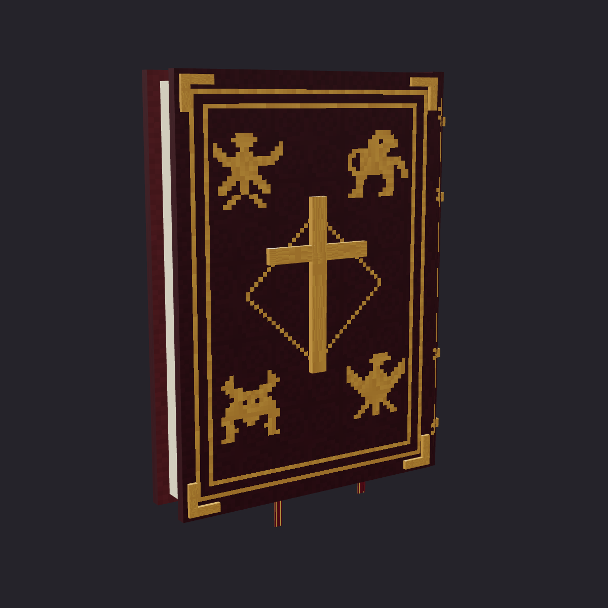

# Evangeliarium

Quatro livros litúrgicos independentes para Minecraft Bedrock: **Evangeliário, Lecionário, Missal Romano e Pontifical Romano**. Cada exemplar pode ser levado nas duas mãos, colocado aberto ou fechado, consultado e recolhido com sua marca preservada.

**Candidato 0.5.2 — 05/11/2026.** Acrescenta ao índice do Missal o formulário da memória de Santa Teresa do Menino Jesus, com transcrição visual e corroboração paroquial brasileira documentadas. Não acrescenta leituras, seleção diária ou aplicação votiva. [Fontes, emenda e limites](docs/SANTA_TERESA_FORMULARY.md); [verificação do pacote](docs/VERIFICATION_0.5.2.md). O Ordo conserva o comportamento da 0.5.1: configuração global por operador, reset na próxima meia-noite de Brasília e consulta de votivas por membros. [Uso e reteste](docs/ORDO_0.5.0.md). Marcas e leituras em andamento permanecem intactas; Pontifical continua por rito. A validação nativa desta versão está pendente. Aspergillum permanece 1.2.5.



## Testar

Importe `dist/releases/Evangeliarium-0.5.2.mcaddon` e ative os packs de comportamento e recursos. Mínimo declarado: Bedrock `26.50`; alvo local de teste: `26.52`. APIs estáveis `@minecraft/server 2.10.0` e `@minecraft/server-ui 2.2.0`, sem experimentos.

```mcfunction
/give @s evangeliarium:book
/give @s evangeliarium:lectionary
/give @s evangeliarium:ordo
/give @s evangeliarium:missal
/give @s evangeliarium:pontifical
```

- O Ordo abre a configuração; agachar + usar coloca o calendário. Somente operadores alteram a celebração.
- Evangeliário, Lecionário e Missal seguem a celebração; Pontifical abre por rito. Escolha o grupo/seção, use Buscar ou retome uma página marcada; `Seções > Livro` reúne marca, créditos e ações do exemplar.
- No Evangeliário, use olhando para o ar para ler. `Leituras` oferece Hoje, Passagem, Data e Livro. Em Passagem, escolha o Evangelho/capítulo ou digite uma referência.
- Use sobre o topo de um bloco cheio de pedra ou madeira para colocar aberto. Agachar + usar deposita fechado.
- Use o livro colocado para abrir e ler. Agachar + usar, quebrar diretamente ou `Retirar` devolve o mesmo item se houver espaço.
- A consulta é privada. Em `Leituras > Livro`, `Marcar passagem` grava a referência; `Seguir hoje` retoma o calendário diário. Fechar fisicamente e Retirar também ficam em Livro.

O rito é romano, com calendário brasileiro e data de Brasília. O calendário nacional tem revisão para **2026–2035** e projeção pelas normas atuais para outras datas gregorianas de 1583 a 9999. Os quatro Evangelhos completos têm **89 capítulos e 3.779 versículos**, da **Bíblia Livre**, licenciada em CC BY 4.0. Não é a tradução litúrgica da CNBB. Tudo funciona offline no jogo. Missal e Pontifical usam as fontes da comunidade, com rubricas e atribuição próprias; não são uma extensão do corpus da Bíblia Livre.

O calendário deriva de referências públicas de uma fonte comunitária, com correções e proveniência documentadas; não constitui homologação litúrgica. Próprios diocesanos e paroquiais não estão incluídos. As consultas por passagem e índice continuam disponíveis independentemente da data.

## Documentação

1. [Implementação, fontes e compatibilidade](docs/RUNTIME.md).
2. [Roteiro de teste no Minecraft](docs/TESTING.md).
3. [Verificação e limites da evidência](docs/VERIFICATION.md), [ferramentas de inspeção no jogo](docs/RUNTIME_DIAGNOSTICS.md).
4. [Histórico de versões](CHANGELOG.md).
5. [Conceito](docs/CONCEPT.md), [pesquisa litúrgica](docs/LITURGY_AND_CONTENT.md), [APIs](docs/BEDROCK_RESEARCH.md), [rig](docs/POSE_AND_MODEL_PLAN.md) e [roadmap](docs/IMPLEMENTATION_ROADMAP.md).

## Produção

Na pasta deste add-on:

```sh
npm ci
npm run check
npm run package
```

Node 24 e dependências instaladas da raiz são necessários para as ferramentas compartilhadas. `assets-src/` contém as fontes autorais; `packs/`, `out/`, `dist/` e `src/generated/` são gerados. `npm run render` reproduz os ícones e vistas do modelo; `npm run capture:pose` captura rigs wide/slim. Essas capturas não substituem o Minecraft.

O protótipo web anterior permanece em [prototype/](prototype/README.md), como histórico de UX. O jogo usa formulários estáveis com [JSON UI próprio](docs/UI_LAYOUT.md). RPs que substituam o mesmo ponto `server_form` podem disputar prioridade. Os identificadores e UUIDs estão em [RUNTIME.md](docs/RUNTIME.md); não reutilizam os do Aspergillum ou da Aurifrita.
